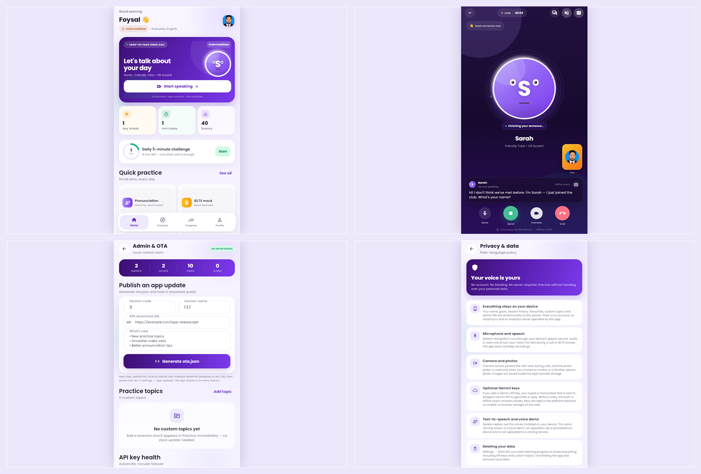

# AI Speaking Partner PRO MAX

[](https://github.com/mmagroscience/ai-speaking-partner-pro-max/releases/latest)



A face-to-face AI speaking coach built with Flutter. The app simulates a video
call with an AI tutor, listens to your voice, replies with a natural-sounding
coach, and gives pronunciation, fluency and vocabulary feedback. It also has an
IELTS speaking mock, a three-tone vocabulary bank, an Oxford 3000 flashcard deck,
a kids school-starter plan, a voice-cloning demo and an over-the-air (OTA)
content admin panel.

## Highlights

- **Face-to-face video call UI** — animated avatar, live subtitles, camera
  self-view, mute/speaker/captions controls, call timer and end-of-call report.
- **Call transcript** — open the transcript from the call and copy the whole
  conversation.
- **Works offline** — a built-in demo coach replies without any API key. Add one
  or more Gemini API keys in Settings to use the online coach; keys rotate
  automatically.
- **Microphone fallback** — if speech recognition cannot hear you twice, the app
  offers a one-tap keyboard reply.
- **Pronunciation coach** — word-by-word scoring with tips and a practice list.
- **IELTS speaking mock** — Part 1, cue-card Part 2 with a 60-second preparation
  timer and two-minute talk timer, Part 3, a band estimate and feedback.
- **Three-tone vocabulary** — formal, neutral and casual versions of each word,
  with a quiz and favourites.
- **Voice cloning flow** — name, photo and audio sample with a simulated
  on-device cloning progress (demo).
- **Bangla / Hindi help** — switch the onboarding and coach help language.
- **PIN-protected admin** — publishing updates and editing practice topics sits
  behind a 4–8 digit PIN (default `1234`, change it in the panel).
- **Privacy-first storage** — no account and no backend. Gemini keys go into the
  Android keystore / iOS Keychain; everything else uses local preferences.
- **Progress backup** — export sessions, streak and custom topics to the
  clipboard as JSON, then import them on another install.
- **Responsive layout** — phones use the full screen; tablets and desktop web
  show a centred 480-pixel app frame.
- **OTA updates** — point the app at a remote `ota.json` or generate one from
  the in-app admin panel.
- **Kids · School Starter** — an 8-week, parent-led plan for 4–6 year olds who
  just started school: picture-word cards, listen-and-repeat sentences, stars
  and a printable daily 10-minute routine. Progress is saved on the device.
- **Oxford 3000 flashcards** — 2,958 words bundled offline across Baby, Class
  1–12 and University. Every card has IPA, part of speech, CEFR level,
  definitions and real Oxford examples, plus an animated 3D flip, picture
  illustration and listen button. Swipe right to mark a word as known.

## What's new in 1.3.0

- New **flashcard module** with 14 levels: Baby, Class 1–12 and University.
- **Oxford 3000 deck** bundled as a 538 KB offline asset: 2,958 words with IPA,
  part of speech, CEFR band, up to two definitions and examples per word.
- Animated flip card with a floating picture illustration, text-to-speech,
  swipe-left to review again, and swipe-right to mark a word as known.
- Curated synonyms, antonyms and common phrases for the most useful words.
- Level picker, per-deck progress, known-word counters and a new **Cards** tab,
  dashboard banner, Practice card and Profile shortcut.
- Flashcard progress travels with backup export/import and learning-data reset.

## What's new in 1.2.0

- New **Kids · School Starter** mode: 8 weeks × 6 picture words + 3 sentence
  patterns, listen-and-repeat audio, 3-star progress and a parent guide.
- Kids progress is included in backup export/import and learning-data reset.
- GitHub Actions now names release files from `pubspec.yaml`, so version bumps
  need no workflow edits.
- New dashboard and Practice entry points for the kids plan.

## What's new in 1.1.0

- Call transcript sheet with copy-to-clipboard.
- Keyboard fallback after repeated empty microphone results.
- Audio/microphone cleanup when the app goes to the background.
- Admin PIN gate and in-panel PIN change.
- API keys moved to platform secure storage (browser storage fallback).
- Progress export/import.
- Privacy & data screen with a Bangla summary.
- First-call empty state on Progress, with a direct route to Practice.
- Scenario cards no longer truncate long titles behind the level pill.
- Larger dashboard tiles, responsive desktop/web frame.
- Monochrome adaptive launcher icon, iOS scaffolding and a CI workflow.
- Release APK/AAB now signed with a generated release keystore.

## Run

```powershell
flutter pub get
flutter run
```

## Build

```powershell
flutter build web --release
flutter build apk --release
flutter build appbundle --release
flutter build apk --release --split-per-abi
```

Release outputs:

- `build/app/outputs/flutter-apk/app-release.apk`
- `build/app/outputs/flutter-apk/app-arm64-v8a-release.apk`
- `build/app/outputs/flutter-apk/app-armeabi-v7a-release.apk`
- `build/app/outputs/flutter-apk/app-x86_64-release.apk`
- `build/app/outputs/bundle/release/app-release.aab`

Signing details live in [SIGNING.md](SIGNING.md). Back up `android/key.properties`
and `android/keystore/` before publishing.

## Build the APK with GitHub Actions

`.github/workflows/release-apk.yml` builds the signed APK, split APKs and the
Play Store bundle. Run it from **Actions → Release APK → Run workflow**, or push
a version tag:

```powershell
git tag v1.3.0
git push origin v1.3.0
```

Tagged builds are attached to the GitHub Release automatically. The workflow
reads these repository secrets:

| Secret | Value |
| --- | --- |
| `ANDROID_KEYSTORE_BASE64` | base64 of `android/keystore/ai_speaking_partner_release.jks` |
| `ANDROID_KEYSTORE_PASSWORD` | keystore password |
| `ANDROID_KEY_PASSWORD` | key password |
| `ANDROID_KEY_ALIAS` | `ai-speaking-partner` |

Without the secrets the workflow still produces an installable APK, signed with
the debug key — fine for testing, not for Play Store updates.

## Project layout

```
lib/
  core/        theme, constants, helpers
  data/        models, catalog, kids plan, flashcard models + Oxford extras
  services/    AI, speech, TTS, pronunciation, IELTS, OTA, flashcards, storage
  state/       AppState (ChangeNotifier + shared_preferences)
  widgets/     shared UI (avatar, cards, buttons, backgrounds)
  screens/     splash, onboarding, home, practice, progress, profile,
               privacy, admin, call, kids, flashcards and update flows
assets/
  branding/    app icon, adaptive foreground + monochrome layer
  audio/       ringtone
  fonts/       Poppins + Hind Siliguri
  ota_config.json
  oxford_3000.json  offline Oxford 3000 deck
```

## Tests

```powershell
flutter analyze
flutter test
```

The suite covers the offline coach, catalog integrity, call screen, admin PIN,
progress export/import, the kids plan, study-level mapping, Oxford deck slicing
and flashcard persistence.

## Optional AI keys

Open **Profile → Settings → AI coaching → Add** and paste one or more Gemini API
keys. Without keys the app stays fully usable with the offline demo coach. Keys
are stored in the platform keystore on mobile and are never committed to the
project.

## Privacy

There is no account, analytics or backend. Microphone, camera and photo access
are used only while practising. The full policy is available in the app under
**Profile → Privacy & data**.
